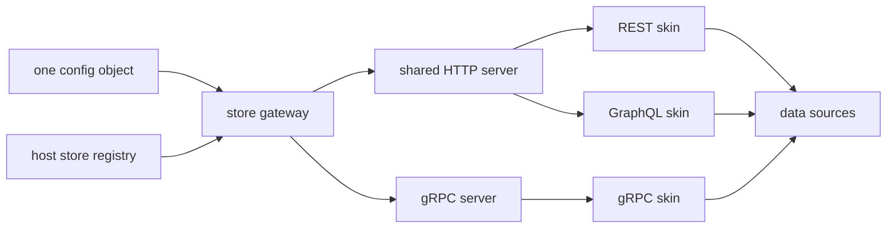

# store-gateway

**One config object that assembles the three common-store API skins — REST, GraphQL and gRPC — from a single call, with per-skin switches and a hot re-assembly endpoint.**

> 中文: [README.md](./README.md)


- **One assembly, three surfaces.** REST and GraphQL share one HTTP server; gRPC gets its own listener.
- **Off by default.** A skin is loaded only when its section says `enabled: true`.
- **Reload without restart.** `POST /-/reload` rebuilds the HTTP side and swaps the handler atomically.

## Imagine three deploy scripts for one schema

Picture a Tuesday morning on a team that exposes the same `User` schema over three protocols. The REST process has its own `rest.config.js`, its own port and its own copy of the model allow-list. The GraphQL process has a second config, a second bootstrap and a second copy of that list. The gRPC process has a third. Each starts the same host store, registers the same schemas, and then mounts exactly one skin.

Nothing is broken, so nobody schedules a fix. But every new model is three edits and three restarts. The three allow-lists drift, and the drift is invisible: `GET /api/User` returns 404 on REST while the GraphQL process happily serves `listUser`. The cost is not latency — it is the number of places that must agree, and the fact that nothing enforces the agreement.

`store-gateway` replaces those three boot files with one object, one `serve()` call, and one place where exposure policy is declared. It does not merge the skins' semantics; it only decides which of them exist in this process.

## What it actually does

The gateway is the assembly point of the skin layer. It reads config, instantiates the enabled skins, and mounts them on their transports. It has no routes of its own beyond the reload endpoint.

| Concern | Handled by the gateway | Handled by the skin |
|---|---|---|
| Which skins exist in this process | ✅ `rest` / `graphql` / `grpc` enable switches | — |
| Listener and port allocation | ✅ shared `http`, separate `grpc` | — |
| REST path prefix, GraphQL endpoint path | ✅ forwarded as skin options | ✅ applies its own routing |
| Model exposure, archived-table filtering | — | ✅ each skin applies its own `resources` |
| Context, permissions, validation | — | ✅ `contextProvider` / guards per skin |
| Runtime re-assembly | ✅ `POST /-/reload` | — |
| Custom endpoints outside the three skins | ✅ `mounts` seam, no semantics added | — |

## Key mechanics

### One assembly, two transports

REST and GraphQL are both HTTP, so they are mounted on **one** Fastify instance (Node) or **one** FastAPI app (Python). They are separated by path only: REST under `rest.prefix`, GraphQL at `graphql.path`. gRPC cannot share that listener, so it gets an independent server on `grpc.host:grpc.port`. The return value reflects this shape: `gw.http.url` plus `gw.grpc.port` (or `null` when the gRPC skin is off).

Per-skin options are passed through untouched. `idField`, `resources`, `contextProvider` / `context_provider`, GraphQL guards — the gateway neither rewrites them nor supplies defaults. Each skin's own spec remains the single source of truth.

### Switches default to false

Every skin starts disabled. Enabling one is an explicit act:

- `enabled` absent or `false` ⇒ the skin is not instantiated and its package is not imported.
- An enabled skin whose package cannot be imported fails at construction — `DEPENDENCY_MISSING` on Node (with the install command in the message), an `ImportError` naming the module on Python.
- All three disabled and no `mounts` ⇒ construction fails with `ERR_NO_SKIN`. A process that is "up" but serves nothing is treated as a configuration bug, not a valid state.

This is fail-fast by design: misconfiguration surfaces before the first request, not as an empty route table in production.

### Reload builds first, swaps second

`POST /-/reload` is answered by the gateway itself, outside the in-flight handler, so it keeps working even if the current snapshot is busy.

1. If `reload: { tenant, env }` is configured, the gateway first calls `store.restoreDefs({ tenant, env })` (Node) or `store.restore_defs` / `restoreDefs` (Python) to rebuild the registry from persisted definitions.
2. A complete new HTTP handler is built from the current registry.
3. Only on success is the in-flight handler replaced. On failure the old routes stay and the endpoint returns `500` with `ERR_RELOAD_FAILED` or the underlying code.
4. Concurrent reloads queue behind a mutex; later callers wait.

The response reports the work done:

```json
{ "data": { "reloaded": true, "resources": 2 } }
```

`resources` counts exposed resources after re-assembly, excluding archived `XxxDeleted` tables when `Xxx` is present. gRPC is outside reload scope — it is an independent server, so changing it requires a fresh `serve()` / `build()`.

### Zero business semantics, one assembly seam

The gateway adds no routes, rewrites no payloads, invents no shared context, and makes no authorization decisions. Its only extension point is `mounts`: a list of functions called after the skins are mounted and before HTTP is ready.

```js
mounts: [(app, ctx) => { app.get('/health', async () => ({ data: 'ok' })); }]
```

On Node the signature is `(app, ctx)` with `ctx = { store }`; on Python it is `(app, store)` and may be async. Mounts run on every reload, so endpoints are rebuilt with the assembly. A throwing mount fails the assembly; `mounts` alone — with no skin enabled — is a legal custom-endpoint service and does not trigger `ERR_NO_SKIN`.

## Run it

| Runtime | Package | Version | Entry point |
|---|---|---|---|
| Node.js ≥ 18 | `store-gateway-node` | 0.2.2 | `require('store-gateway-node').serve` |
| Python ≥ 3.10 | `store-gateway-py` | 0.2.2 | `from store_gateway import build` (async) |

```bash
npm install store-gateway-node
```

```bash
pip install "store-gateway-py[rest,graphql,grpc]"
```

The Python extras map one-to-one to `store-api-py`, `store-graphql-py` and `store-grpc-py`; install only the extras you enable. On Node the skin packages are declared as dependencies and as optional peers, but they are `require`d lazily — an unused skin is never loaded.

### Node.js

The snippet below is self-contained: the embedded `local` store needs no database.

```javascript
const { init, local, store } = require('nodejs-store');
const { serve } = require('store-gateway-node');

await init({ default: local.connect({ dir: './data' }) });

store.register({
  name: 'User',
  fields: { _id: { type: 'string' }, name: { type: 'string' }, age: { type: 'int' } },
});

const gw = await serve(store, {
  http: { host: '127.0.0.1', port: 3000 },       // REST + GraphQL share this server
  rest: { enabled: true, prefix: '/api' },        // needs store-api-node
  graphql: { enabled: true, path: '/graphql' },   // needs store-graphql-node
  grpc: { enabled: true, port: 50051 },           // needs store-grpc-node, own port
});

console.log(gw.http.url);   // http://127.0.0.1:3000
console.log(gw.grpc.port);  // 50051

await gw.close();           // HTTP + gRPC + current app
```

### Python

`build()` is a coroutine; `gw.run()` blocks on uvicorn for the HTTP side, while the gRPC server is already started inside `build()`.

```python
import asyncio

from py_store import init, local, store
from store_gateway import build


async def main():
    await init({'default': local.connect({'dir': './data'})})
    store.register({
        'name': 'User',
        'fields': {'_id': {'type': 'string'}, 'name': {'type': 'string'}, 'age': {'type': 'int'}},
    })

    gw = await build(
        store,
        rest={'enabled': True, 'prefix': '/api'},
        graphql={'enabled': True, 'path': '/graphql'},
        grpc={'enabled': True, 'port': 50051},
    )
    gw.run('127.0.0.1', 3000)


asyncio.run(main())
```

### Same schema, three calls

```bash
curl http://127.0.0.1:3000/api/User

curl -X POST http://127.0.0.1:3000/graphql \
  -H 'content-type: application/json' \
  -d '{"query":"{ listUser { name age } }"}'

curl -X POST http://127.0.0.1:3000/-/reload
```

### Configuration reference

Both runtimes accept the same shape. Unknown top-level keys are ignored; unknown keys inside a skin section are forwarded to that skin.

| Key | Default | Meaning |
|---|---|---|
| `http.host` | `127.0.0.1` | Host for the shared HTTP server. |
| `http.port` | `3000` | Port for the shared server. `0` asks the OS for a free port; the real value is in `gw.http.url`. |
| `rest.enabled` | `false` | Mount the REST skin. |
| `rest.prefix` | root on Node; `/api` on the Python gateway | Base path; each model gets `/prefix/{name}`. |
| `graphql.enabled` | `false` | Mount the GraphQL skin. |
| `graphql.path` | `/graphql` | `GET` serves the documentation page, `POST` executes queries. |
| `grpc.enabled` | `false` | Mount the gRPC skin. |
| `grpc.host` | `127.0.0.1` | Host for the independent gRPC server. |
| `grpc.port` | `50051` | Port for the gRPC server; `0` is OS-assigned. |
| `mounts` | `[]` | Assembly-time mount functions; run after skins, before HTTP ready, again on every reload. |
| `reload.tenant` / `reload.env` | — | If `reload` is set, both are required; registry is rebuilt for this namespace before each re-assembly. |
| other skin keys | — | Passed through verbatim: `idField`, `resources`, `contextProvider`, GraphQL guards, etc. |

## Boundaries: when not to use it

- **You only need one protocol.** Use `store-api`, `store-graphql` or `store-grpc` directly; the gateway adds a layer without adding capability.
- **You need business logic, validation or authorization decisions in the API layer.** The gateway composes; each skin owns its own context and permissions. There is no place here to invent policy.
- **You need the MCP skin.** The gateway mounts REST, GraphQL and gRPC only; `store-mcp` stands alone.
- **You need runtime route registration inside a skin.** Skins are assembly-time snapshots. A schema registered later appears only after a full `POST /-/reload`.
- **You expect gRPC to be hot-reloadable.** It is an independent server and is deliberately out of reload scope.
- **You want REST and GraphQL on different ports.** They share the `http` server and are separated by path only; keep `rest.prefix` and `graphql.path` distinct.

## Where it sits in the family

It is the assembly layer directly above the skin layer: hosts provide the `store`, skins provide protocol semantics, and the gateway decides which skins this process exposes.

| Project | Role |
|---|---|
| [`rust-store`](https://github.com/coenddt/rust-store) | Shared engine (`rust-store-core`) and language bindings. |
| [`nodejs-store`](https://github.com/coenddt/nodejs-store) | Node.js host providing the `store` instance. |
| [`py-store`](https://github.com/coenddt/py-store) | Python host (`storepy`, import `py_store`). |
| [`store-api`](https://github.com/coenddt/store-api) | REST skin. |
| [`store-graphql`](https://github.com/coenddt/store-graphql) | GraphQL skin. |
| [`store-grpc`](https://github.com/coenddt/store-grpc) | gRPC skin. |
| [`store-mcp`](https://github.com/coenddt/store-mcp) | MCP skin, not combined here. |
| [`meta-store`](https://github.com/coenddt/meta-store) | Definition control plane; its output becomes visible through one reload. |

## One diagram



License: MIT — see [LICENSE](./LICENSE).
