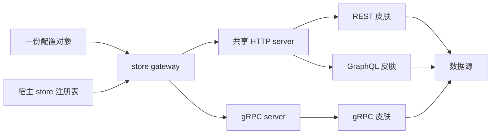

# store-gateway

**一份配置对象，一次 `serve()` 调用，装配出 common-store 的三层协议面——REST、GraphQL、gRPC。每层有独立开关，HTTP 侧可热重装配。给同时维护多种协议面的服务端团队用。**

> English: [README.en.md](./README.en.md)


- **一次装配，三种面。** REST 与 GraphQL 共用一个 HTTP server；gRPC 单独监听。
- **默认关闭。** 只有配置段写了 `enabled: true` 的皮肤才会被加载。
- **不重启就换装。** `POST /-/reload` 重建 HTTP 侧，原子替换在途 handler。

## 周二早上，三份部署脚本

一个团队要把同一份 `User` schema 暴露在三种协议上。REST 进程有自己的 `rest.config.js`、自己的端口、自己的一份模型白名单。GraphQL 进程有第二份配置、第二套引导、第二份白名单。gRPC 进程有第三份。

三个进程各自启动同一个宿主 store，注册同一批 schema，然后只挂一种皮。

这不算坏，所以没人排期修。但每加一个模型就是三处改动、三次重启。三份白名单开始漂移，而漂移是不可见的：`GET /api/User` 在 REST 上返回 404，GraphQL 进程却高高兴兴地服务 `listUser`。成本不在延迟，而在于「必须保持一致的地方」有几个，以及没有任何东西强制执行这种一致。

`store-gateway` 用一份对象、一次 `serve()` 调用、一处暴露策略声明，替掉那三个启动文件。它不合并各层皮肤的语义，只决定这个进程里哪几层存在。

## 它到底做什么

gateway 是皮肤层的装配点。它读配置、实例化已启用的皮肤、把它们挂到各自的承载上。除了 reload 端点，它自己没有路由。

| 事项 | 由 gateway 负责 | 由皮肤负责 |
|---|---|---|
| 这个进程里有哪些皮肤 | ✅ `rest` / `graphql` / `grpc` 开关 | — |
| 监听器与端口分配 | ✅ 共享 `http`，独立 `grpc` | — |
| REST 路径前缀、GraphQL 端点路径 | ✅ 作为皮肤选项转发 | ✅ 应用自己的路由 |
| 模型暴露、归档表过滤 | — | ✅ 各皮肤应用自己的 `resources` |
| 上下文、权限、校验 | — | ✅ 各皮肤的 `contextProvider` / 守卫 |
| 运行期重装配 | ✅ `POST /-/reload` | — |
| 三层皮肤之外的定制端点 | ✅ `mounts` 接缝，不新增语义 | — |

## 关键机制

### 一次装配，两种承载

REST 与 GraphQL 都是 HTTP，所以挂在**同一个** Fastify 实例（Node）或**同一个** FastAPI 应用（Python）上。二者只靠路径区分：REST 在 `rest.prefix` 下，GraphQL 在 `graphql.path`。

gRPC 无法共享这个监听器，因此拿到独立的 `grpc.host:grpc.port`。返回值如实反映这个形状：`gw.http.url` 加 `gw.grpc.port`（gRPC 关闭时为 `null`）。

逐皮肤选项原样透传。`idField`、`resources`、`contextProvider` / `context_provider`、GraphQL 守卫——gateway 既不重写也不补默认值。每层皮肤自己的 spec 仍是唯一事实源。

### 开关默认为 false

每层皮肤初始都是关闭的。启用是一个显式动作：

- `enabled` 缺失或为 `false` ⇒ 皮肤不实例化，其包也不被导入。
- 启用了但包导入失败 ⇒ 构造期直接失败：Node 抛 `DEPENDENCY_MISSING`（消息里带安装命令），Python 抛 `ImportError` 并点名缺失模块。
- 三层全关且没有 `mounts` ⇒ 构造失败，`ERR_NO_SKIN`。一个「起来了但什么都不服务」的进程被视为配置错误，不是合法状态。

这是刻意的 fail-fast：配置错误在第一个请求之前暴露，而不是在生产环境表现为一张空路由表。

### reload 先构建，后替换

`POST /-/reload` 由 gateway 自己承接，不进入在途 handler，所以即使当前快照正忙它也照常工作。

1. 若配置了 `reload: { tenant, env }`，先调 `store.restoreDefs({ tenant, env })`（Node）或 `store.restore_defs` / `restoreDefs`（Python），从持久化定义重建注册表。
2. 用当前注册表构建一份完整的新 HTTP handler。
3. 只有构建成功才替换在途 handler。失败则保留旧路由，端点返回 `500`，code 为 `ERR_RELOAD_FAILED` 或底层错误码。
4. 并发 reload 在互斥锁上排队，后到者等待。

响应如实报告这次干了什么：

```json
{ "data": { "reloaded": true, "resources": 2 } }
```

`resources` 是重装配后暴露的资源数；当 `Xxx` 存在时，归档表 `XxxDeleted` 不计入。gRPC 不在 reload 范围内——它是独立 server，改它需要重新 `serve()` / `build()`。

### 零业务语义，一个装配接缝

gateway 不加路由、不改写载荷、不发明共享上下文、不做鉴权裁决。它唯一的扩展点是 `mounts`：一组函数，在皮肤挂载之后、HTTP 就绪之前依次执行。

```js
mounts: [(app, ctx) => { app.get('/health', async () => ({ data: 'ok' })); }]
```

Node 的签名是 `(app, ctx)`，`ctx = { store }`；Python 是 `(app, store)`，可以是 async。每次 reload 都会重跑 mounts，所以这些端点随装配一起重建。mount 抛错会让本次装配失败。只有 `mounts`、不启用任何皮肤，是一个合法的自定义端点服务，不触发 `ERR_NO_SKIN`。

## 依赖版本要求

> 本节与下方表格里的 `0.3.0` / `1.0.0` 均为**目标版本**，随本批次统一发布；发布前 registry 上仍是旧线，请从本仓源码安装。

> ⚠️ **gateway 的皮肤依赖必须指向 store-api 1.0.0。** 若安装时仍写 `^0.6.3`，装出来的进程是坏的：caret 把上限锁在 `0.6.x`（`^0.6.3` ≡ `>=0.6.3 <0.7.0`），npm 根本不会解析到 `1.0.0`，运行期加载的仍是旧皮，与 `nodejs-store 5.1.3+` / core 5.x 不兼容，请求直接 500。安装阶段不报错，错误只在运行期出现。

三个皮肤（`store-api-node` / `store-graphql-node` / `store-grpc-node`）必须与 **store-api 1.0.0** 同一发布批次升级，不要混搭。gateway 0.3.0 自身已把三个皮肤的依赖与 peer 下限都抬到 `>=1.0.0 <2.0.0`；Python 侧 `rest` / `graphql` / `grpc` 三个 extra 分别为 `store-api-py>=1.0.0,<2.0.0`、`store-graphql-py>=1.0.0,<2.0.0`、`store-grpc-py[grpc]>=1.0.0,<2.0.0`。混搭（例如 api 1.0.0 + graphql 0.6.2）会让 GraphQL 装配直接报 `Expected {...} to be a GraphQL schema`。

**Node 正确安装（三皮一起装）：**

```bash
npm i store-gateway-node@0.3.0 store-api-node@^1.0.0 store-graphql-node@^1.0.0 store-grpc-node@^1.0.0 nodejs-store@^5.1.3
```

只启用 REST 时，可只装 `store-api-node@^1.0.0`；一旦启用 GraphQL / gRPC，对应皮肤也必须取 `^1.0.0`，不要停留在 `0.6.x` / `0.2.x`。

**Python 正确安装：**

```bash
pip install "store-gateway-py[rest]>=0.3.0" "store-api-py>=1.0.0,<2.0.0"
```

`graphql` / `grpc` extras 各自带了下限（`store-graphql-py>=1.0.0,<2.0.0`、`store-grpc-py[grpc]>=1.0.0,<2.0.0`），启用时直接装对应 extra 即可。

**装完核对实际解析结果——看到 0.6.x / 0.2.x 就是装错了：**

```bash
npm ls store-api-node store-graphql-node store-grpc-node   # 须全为 1.0.x
```

```bash
pip show store-api-py store-graphql-py store-grpc-py        # 须全为 1.0.x
```

已装错时，先在应用 `package.json` 里显式把三个皮肤一起提到 `^1.0.0`（不要指望传递依赖自动跟进旧范围），清掉 `node_modules` 与锁文件后重装，再用上面的命令复核。

> **GraphQL 权限判定的行为变化**：store-graphql 1.0.0 起，执行期权限拒绝返回 HTTP 200 + `errors[0].extensions.code === 'FORBIDDEN'`（旧皮是 403）；预执行阶段仍为 403/401。按状态码判权限的调用方需要改读 `extensions.code`。REST 不受影响，仍为 403。

## 跑起来

| 运行时 | 包 | 目标版本 | 入口 |
|---|---|---|---|
| Node.js ≥ 18 | `store-gateway-node` | 0.3.0 | `require('store-gateway-node').serve` |
| Python ≥ 3.10 | `store-gateway-py` | 0.3.0 | `from store_gateway import build`（async）、`Gateway.serve` |

```bash
npm install store-gateway-node@0.3.0 store-api-node@^1.0.0 nodejs-store@^5.1.3
```

```bash
pip install "store-gateway-py[rest]>=0.3.0" "store-api-py>=1.0.0,<2.0.0"
```

上面的命令覆盖 REST 皮肤，按需替换 extra 为 `rest` / `graphql` / `grpc`，完整组合见上一节「依赖版本要求」。Python 的 extras 与 `store-api-py`、`store-graphql-py`、`store-grpc-py` 一一对应，只装你要启用的；`grpc` extra 已带上 `store-grpc-py[grpc]` 的完整依赖。Node 侧皮肤包声明为依赖兼 optional peer，但都是惰性 `require`——没用到的皮肤从不加载。

### Node.js

下面这段是自包含的：内嵌的 `local` store 不需要数据库。

```javascript
const { init, local, store } = require('nodejs-store');
const { serve } = require('store-gateway-node');

await init({ default: local.connect({ dir: './data' }) });

store.register({
  name: 'User',
  fields: { _id: { type: 'string' }, name: { type: 'string' }, age: { type: 'int' } },
});

const gw = await serve(store, {
  http: { host: '127.0.0.1', port: 3000 },       // REST + GraphQL 共享此 server
  rest: { enabled: true, prefix: '/api' },        // 需要 store-api-node
  graphql: { enabled: true, path: '/graphql' },   // 需要 store-graphql-node
  grpc: { enabled: true, port: 50051 },           // 需要 store-grpc-node，独立端口
});

console.log(gw.http.url);   // http://127.0.0.1:3000
console.log(gw.grpc.port);  // 50051

await gw.close();           // HTTP + gRPC + 当前 app
```

### Python

`build()` 是协程。`Gateway.serve(host='127.0.0.1', port=3000)` 也是协程：在事件循环内必须 `await gw.serve()`（内部 `uvicorn.Server.serve`，省略参数即 `127.0.0.1:3000`）；在协程外才可用阻塞的 `gw.run()`。gRPC server 在 `build()` 内部已经启动，`serve()` 只承载 HTTP。

```python
import asyncio

from py_store import init, local, store
from store_gateway import build


async def main():
    await init({'default': local.connect({'dir': './data'})})
    store.register({
        'name': 'User',
        'fields': {'_id': {'type': 'string'}, 'name': {'type': 'string'}, 'age': {'type': 'int'}},
    })

    gw = await build(
        store,
        rest={'enabled': True, 'prefix': '/api'},
        graphql={'enabled': True, 'path': '/graphql'},
        grpc={'enabled': True, 'port': 50051},
    )
    await gw.serve('127.0.0.1', 3000)


asyncio.run(main())
```

### 同一份 schema，三次调用

```bash
curl http://127.0.0.1:3000/api/User

curl -X POST http://127.0.0.1:3000/graphql \
  -H 'content-type: application/json' \
  -d '{"query":"{ listUser { name age } }"}'

curl -X POST http://127.0.0.1:3000/-/reload
```

### 配置参考

两个运行时接受同一形状。不认识的顶层键被忽略；皮肤段内不认识的键转发给该皮肤。

| 键 | 缺省 | 含义 |
|---|---|---|
| `http.host` | `127.0.0.1` | 共享 HTTP server 的主机。 |
| `http.port` | `3000` | 共享 server 的端口。`0` 让 OS 分配，真实值在 `gw.http.url`。 |
| `rest.enabled` | `false` | 是否挂载 REST 皮肤。 |
| `rest.prefix` | Node 为根；Python gateway 为 `/api` | 基础路径；每模型挂在 `/prefix/{name}`。 |
| `graphql.enabled` | `false` | 是否挂载 GraphQL 皮肤。 |
| `graphql.path` | `/graphql` | `GET` 提供文档页，`POST` 执行查询。 |
| `grpc.enabled` | `false` | 是否挂载 gRPC 皮肤。 |
| `grpc.host` | `127.0.0.1` | 独立 gRPC server 的主机。 |
| `grpc.port` | `50051` | gRPC 端口；`0` 由 OS 分配。 |
| `mounts` | `[]` | 装配期挂载函数；皮肤之后、HTTP 就绪之前运行，每次 reload 重跑。 |
| `reload.tenant` / `reload.env` | — | 设置 `reload` 后两者必填；每次重装配前按该命名空间重建注册表。 |
| 其余皮肤键 | — | 原样透传：`idField`、`resources`、`contextProvider`、GraphQL 守卫等。 |

## 边界：什么时候不要用它

- **只需要一种协议。** 直接用 `store-api`、`store-graphql` 或 `store-grpc`。gateway 只多一层，不多一份能力。
- **需要在 API 层写业务逻辑、校验或鉴权裁决。** gateway 只做组合，上下文与权限归各皮肤。这里没有地方发明策略。
- **需要 MCP 皮肤。** gateway 只挂 REST、GraphQL、gRPC；`store-mcp` 独立使用。
- **需要在皮肤内做运行期路由注册。** 皮肤是装配期快照。后注册的 schema 要等一次完整的 `POST /-/reload` 才出现。
- **指望 gRPC 可热重载。** 它是独立 server，被刻意排除在 reload 之外。
- **想让 REST 与 GraphQL 用不同端口。** 它们共享 `http` server，只靠路径区分，所以 `rest.prefix` 与 `graphql.path` 必须错开。

## 在家族里的位置

它是紧贴皮肤层之上的装配层：宿主提供 `store`，皮肤提供协议语义，gateway 决定这个进程对外暴露哪几层。

| 项目 | 角色 |
|---|---|
| [`rust-store`](https://github.com/coenddt/rust-store) | 共享引擎（`rust-store-core`）与各语言绑定。 |
| [`nodejs-store`](https://github.com/coenddt/nodejs-store) | Node.js 宿主，提供 `store` 实例。 |
| [`py-store`](https://github.com/coenddt/py-store) | Python 宿主（`storepy`，import `py_store`）。 |
| [`store-api`](https://github.com/coenddt/store-api) | REST 皮肤。 |
| [`store-graphql`](https://github.com/coenddt/store-graphql) | GraphQL 皮肤。 |
| [`store-grpc`](https://github.com/coenddt/store-grpc) | gRPC 皮肤。 |
| [`store-mcp`](https://github.com/coenddt/store-mcp) | MCP 皮肤，不在此组合内。 |
| [`meta-store`](https://github.com/coenddt/meta-store) | 定义控制面；它的产物经一次 reload 变得可见。 |

## 一图看懂



三句话：一份配置决定哪几层存在；REST 与 GraphQL 共用端口靠路径分开；改 HTTP 侧只需一次 reload，gRPC 得重新装配。

License: MIT —— 见 [LICENSE](./LICENSE)。
